<div align="center">

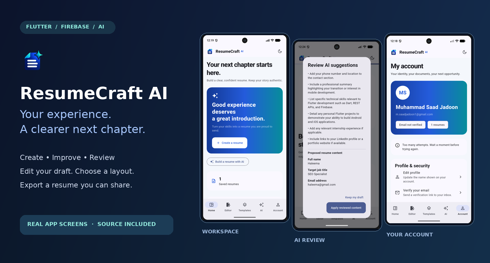

# ResumeCraft AI

### Your experience. A clearer next chapter.

A Flutter resume workspace with AI creation and editing, Firebase accounts, cloud drafts and PDF export.


[Explore the app](#a-look-inside) · [Run locally](#run-locally) · [Verify the project](#verify-the-project) · [Detailed setup](docs/SETUP.md)

</div>

## Built around your next opportunity

Start with your own facts, turn them into a structured draft, and review AI suggestions before saving changes. ResumeCraft AI keeps the editor, templates, account and export tools in one workspace.

| Workspace | What you can do |
| --- | --- |
| Create with AI | Supply actual skills, education and experience; review a proposed new resume before saving. |
| Improve & review | Select an existing draft, provide a target role, and inspect suggested content or advice. |
| Resume editor | Edit contact details, summary, skills, experience, education, projects and more. |
| Templates | Choose Modern, Classic or Minimal with an accent color. |
| PDF tools | Preview, print and share/export a generated PDF. |
| Import & backup | Import supported PDF/profile text and export/import JSON backups. |
| Account | Email/password sign-in, profile name editing, verification, password reset and sign-out. |
| Draft storage | Device storage plus authenticated Firestore sync; retry sync when it fails. |
| Preferences | Light/dark appearance and backend configuration checks. |

AI output needs human review. Job descriptions provide context; they are not evidence of experience. Cloud sync and AI generation depend on correctly configured external services.

## A look inside

These are the supplied app screenshots, presented without hiding their original state. Tap any image to inspect it.

### 01 · Start your workspace

Create or reopen a draft, then enter your real experience.

<table>
<tr><th>Dashboard</th><th>Saved drafts</th><th>Resume editor</th></tr>
<tr>
<td align="center"><a href="docs/screenshots/dashboard.png">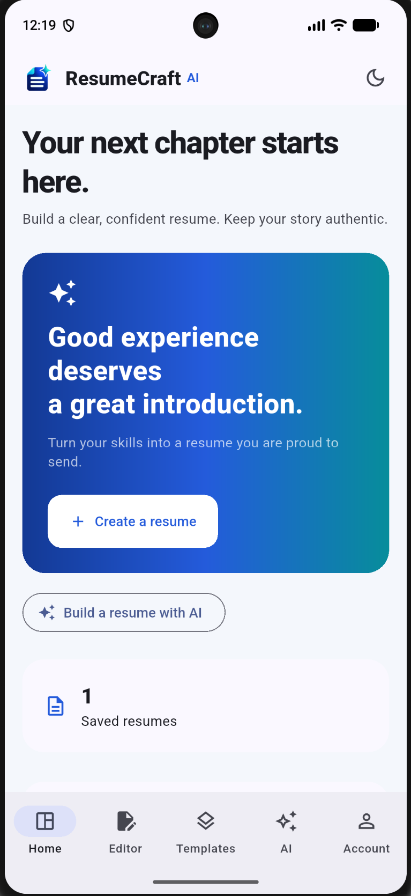</a></td>
<td align="center"><a href="docs/screenshots/saved-resumes.png">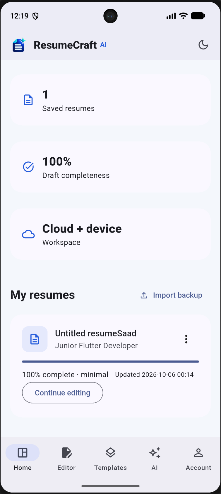</a></td>
<td align="center"><a href="docs/screenshots/resume-editor.png">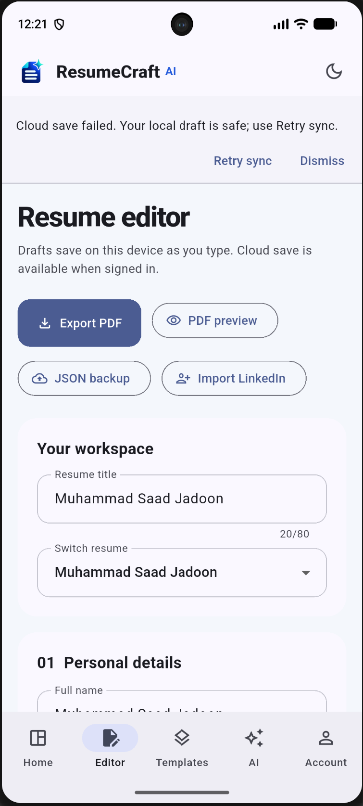</a></td>
</tr>
</table>

### 02 · Style and improve

Choose a layout, inspect proposed improvements, and review targeted advice.

<table>
<tr><th>Choose a template</th><th>Review improvements</th><th>Review career advice</th></tr>
<tr>
<td align="center"><a href="docs/screenshots/templates.png">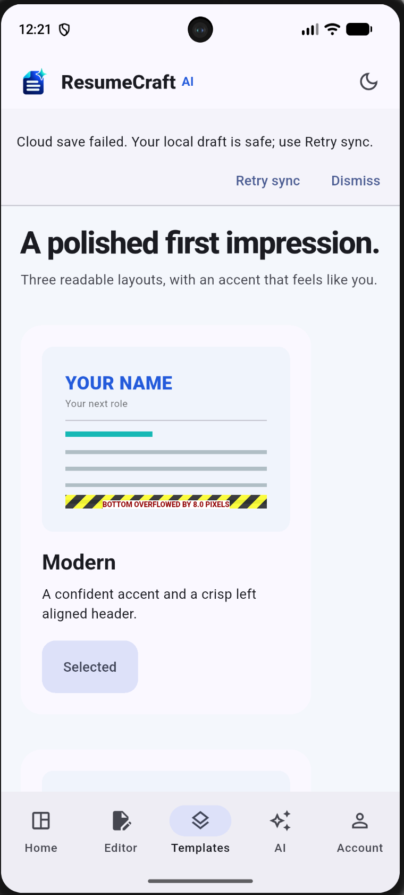</a></td>
<td align="center"><a href="docs/screenshots/ai-improvement.png">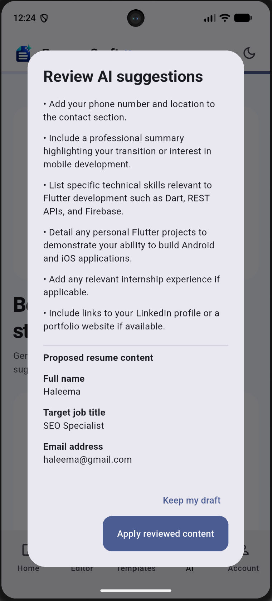</a></td>
<td align="center"><a href="docs/screenshots/ai-review.png">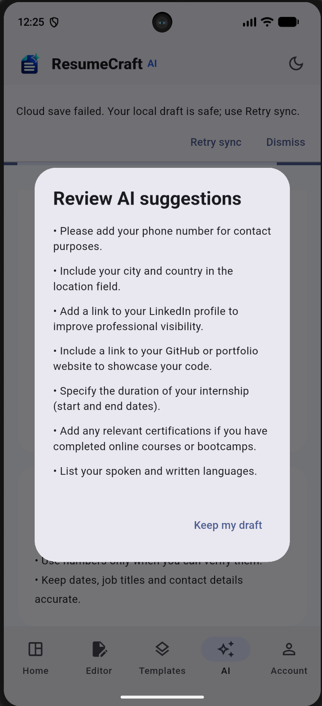</a></td>
</tr>
</table>

### 03 · Preview and export

Inspect the generated document before sharing or printing it.

<table>
<tr><th>Generated resume</th><th>PDF preview</th><th>Print & export</th></tr>
<tr>
<td align="center"><a href="docs/screenshots/generated-resume.png"></a></td>
<td align="center"><a href="docs/screenshots/pdf-preview.png">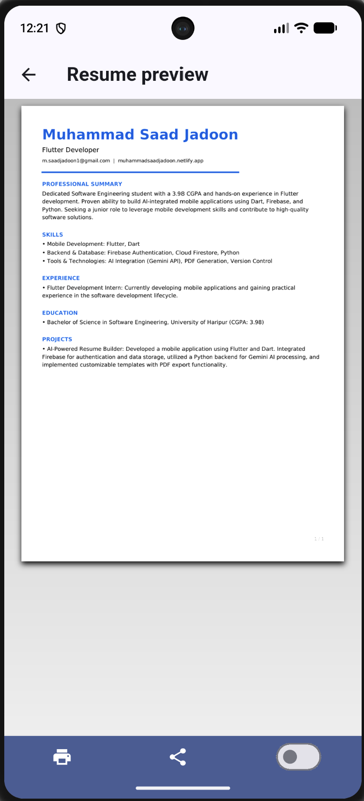</a></td>
<td align="center"><a href="docs/screenshots/print-export.png">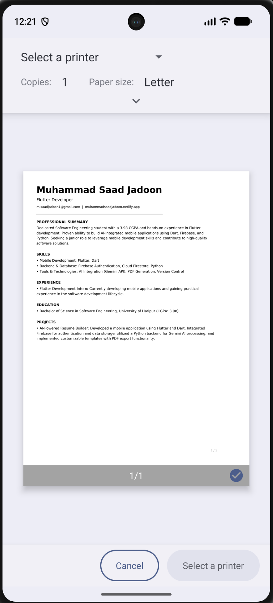</a></td>
</tr>
</table>

### 04 · Manage your account

Move from local drafts to your signed-in workspace and adjust appearance.

<table>
<tr><th>Local workspace</th><th>Signed-in account</th><th>Dark appearance</th></tr>
<tr>
<td align="center"><a href="docs/screenshots/account-local.png">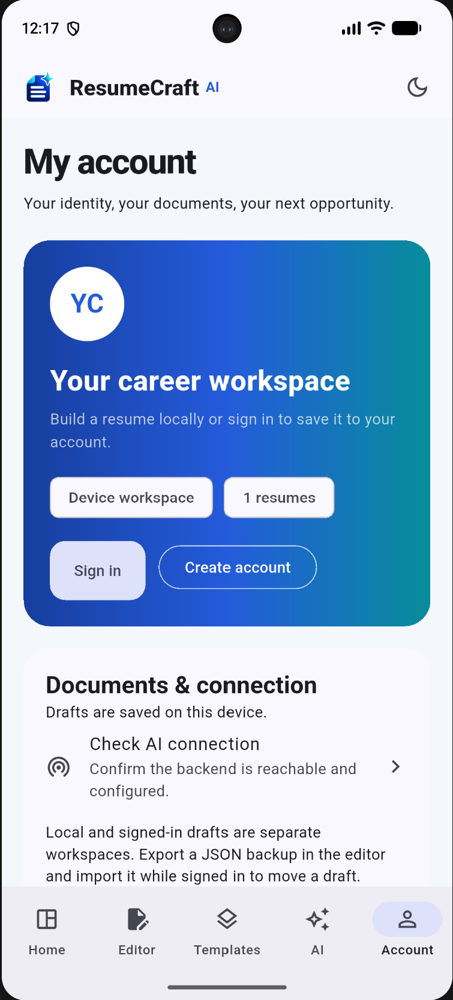</a></td>
<td align="center"><a href="docs/screenshots/account-signed-in.png">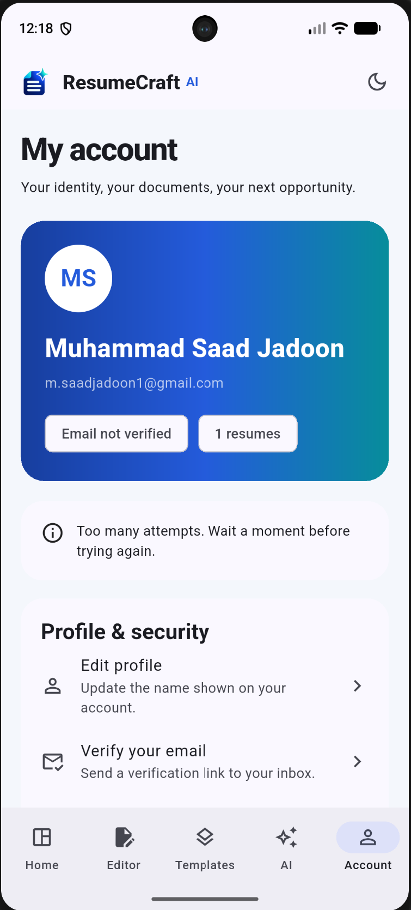</a></td>
<td align="center"><a href="docs/screenshots/account-dark.png">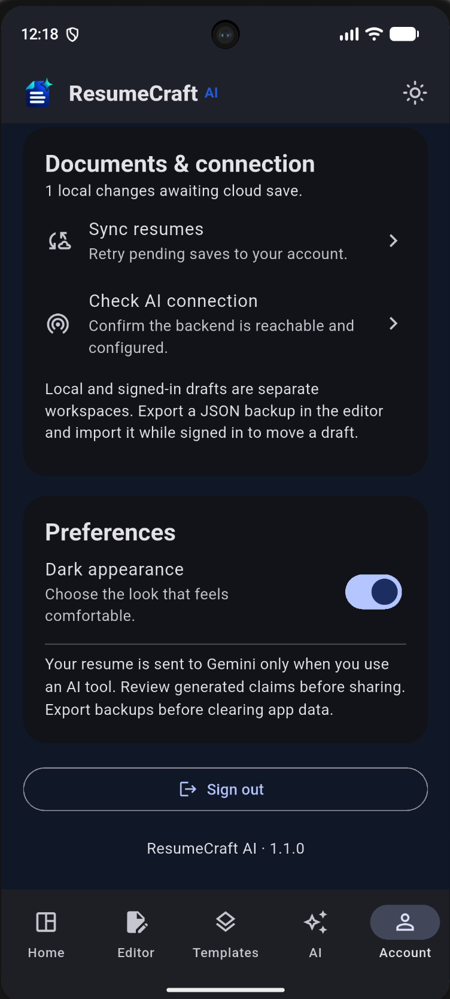</a></td>
</tr>
</table>

> Screenshot status: some captures show cloud-save warnings, an authentication retry notice and a template preview overflow marker. They document the captured app state, not a claim that every service passed verification. This package removes the template preview's fixed-height constraint and adds a regression test; local Flutter execution is still required.

## How it connects

Flutter stores local drafts and connects to Firebase Authentication/Firestore. AI requests go to the FastAPI backend with a Firebase ID token. The backend validates the token and calls Gemini using a server-side key. Gemini keys and Admin credentials belong only on the server.

```text
lib/                 Flutter UI, models, storage, PDF and API services
test/                Model, PDF, widget and API client tests
backend/             FastAPI service, configuration example and 30 backend tests
assets/              App logo, PDF fonts and font license
docs/                Setup guide, hero image and all 12 screenshots
scripts/             Fresh-checkout platform setup and verification
.github/workflows/   Backend and Flutter CI checks
firestore.rules      Per-user draft access rules
```

## Run locally

**Requirements:** Flutter ≥3.35 with Dart ≥3.9, Android Studio/SDK for Android, and Python 3.10+. Run `flutter doctor` before setup.

### 1. Generate native platforms for a fresh checkout

From this repository root, in PowerShell:

```powershell
.\scripts\bootstrap.ps1
```

Native Android/iOS/web folders were absent from the uploaded source and are generated by this script. Android uses `com.saadi.resumecraft_ai`. For an existing working project, follow [the update guide](docs/SETUP.md) and preserve its native folders and private configuration instead of running bootstrap.

### 2. Configure Firebase and the backend

```powershell
Copy-Item dart_defines.android.example.json dart_defines.json
Copy-Item backend\.env.example backend\.env
```

Fill the Android Firebase API key/app ID/project/sender values using your registered app's `google-services.json`. Match the Android package to its Firebase registration. Enable Email/Password authentication, create Firestore, and publish the supplied `firestore.rules` in the Firebase Console. Use the same Firebase project ID in Flutter and backend configuration.

Backend `.env`:

```dotenv
GEMINI_API_KEY=your_server_side_key
GEMINI_MODEL=your_tested_generateContent_model
FIREBASE_PROJECT_ID=your_firebase_project_id
APP_ENV=development
DEV_NO_AUTH=false
CHECK_REVOKED=false
CORS_ORIGINS=http://localhost:8080
```

Use a model available to your key and test generation, not only model listing. A successful `/health` response reports configuration, not a live generation test. Google 403 access denial, quota exhaustion and 503 overload require their respective service/configuration resolution; this source cannot guarantee provider availability.

Default Firebase verification uses public signing certificates and checks token signature, issuer, project and expiry. Immediate revocation/disabled-account checks require `CHECK_REVOKED=true` and server-side Firebase Admin credentials. See [setup details](docs/SETUP.md).

### 3. Start the backend

Terminal 1:

```powershell
cd backend
python -m venv .venv
.\.venv\Scripts\python.exe -m pip install -r requirements.txt
.\.venv\Scripts\python.exe -m uvicorn app:app --host 0.0.0.0 --port 8081
```

### 4. Launch Android

Start your emulator in Android Studio Device Manager. Terminal 2, repository root:

```powershell
flutter devices
flutter run -d YOUR_EMULATOR_ID --dart-define-from-file=dart_defines.json
```

For Android Studio's emulator, use `API_BASE_URL=http://10.0.2.2:8081`. Physical devices need the backend computer's reachable LAN IP. Web uses `http://localhost:8081` and the web Firebase app's configuration. Debug HTTP is enabled by the platform setup script; production hosting should use HTTPS.

## Verify the project

Run from the repository root after platform setup and backend dependency installation:

```powershell
.\scripts\verify.ps1
```

Or run the checks individually:

```powershell
flutter pub get
dart format lib test scripts
flutter analyze --no-fatal-infos
flutter test
Push-Location backend
.\.venv\Scripts\python.exe -m pytest tests -q
Pop-Location
flutter build apk --debug --dart-define-from-file=dart_defines.json
Invoke-RestMethod http://localhost:8081/health
```

An emulator smoke test should create/edit a draft, open all three templates, preview/export PDF, create and improve a CV through AI, sign in/out and verify Firestore sync. Test at phone and desktop widths and after opening the keyboard.

**Delivery evidence:** backend tests pass; Dart syntax parsing passes. Flutter SDK was unavailable in the packaging environment, so Flutter analysis/tests, generated-platform builds and emulator runs are unverified here. Read [VERIFICATION.md](VERIFICATION.md) for scope. GitHub Actions is included but has not been run against your future repository.

## Publish to GitHub

Create an empty repository, then run from this folder:

```powershell
git init
git add .
git status
git commit -m "Add ResumeCraft AI source, screenshots and setup"
git branch -M main
git remote add origin https://github.com/YOUR_USERNAME/YOUR_REPOSITORY.git
git push -u origin main
```

Review staged files before committing. `.env`, real dart-defines, service-account keys, virtual environments and build output are ignored. Screenshots contain the profile details you supplied; review them before publishing publicly. No private credentials are included in this package. No application license was selected on your behalf; the bundled font license remains in `assets/fonts/LICENSE.txt`.
